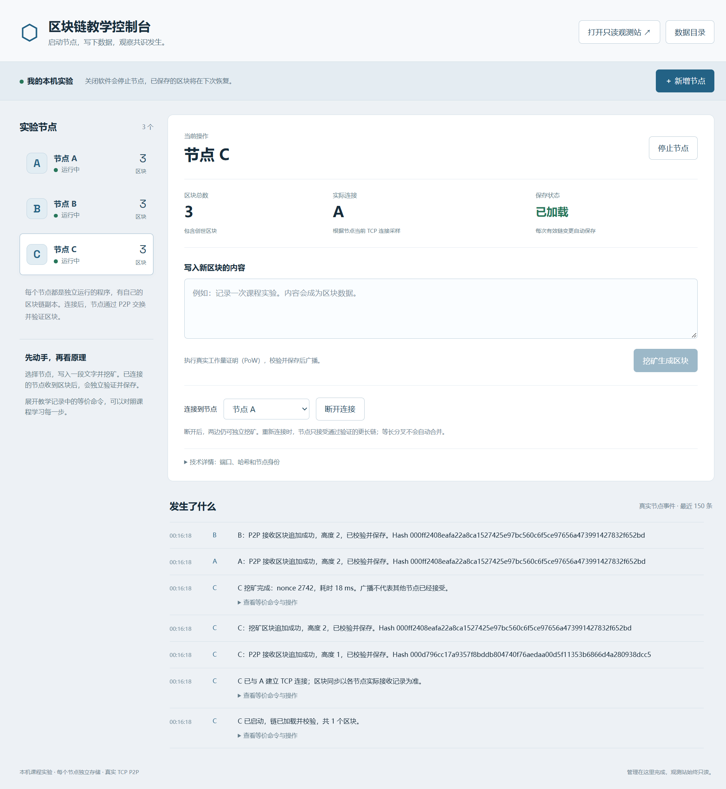
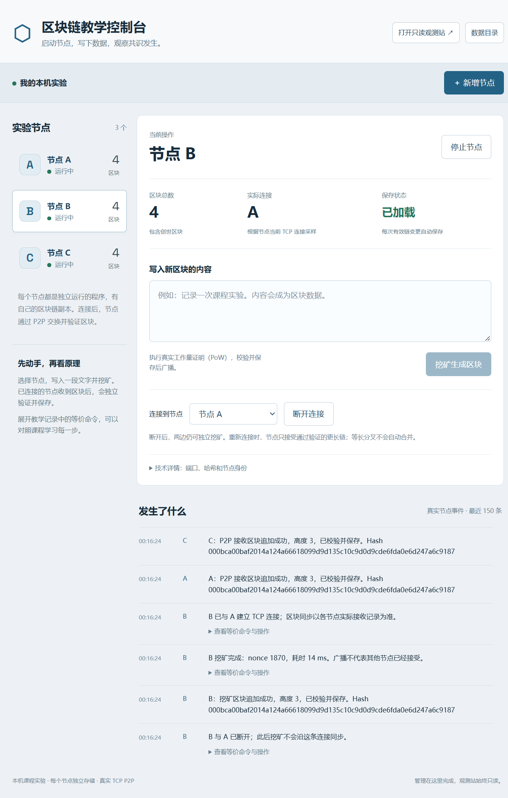
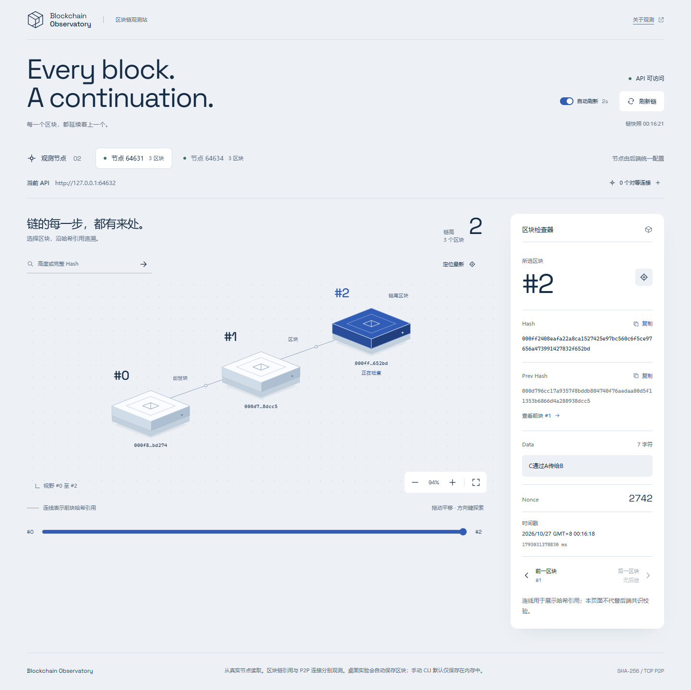

# 真实截图与逐步讲解

所有截图由本仓库脚本在独立测试环境生成，不拍摄作者桌面或读取个人实验。临时端口可能与README固定示例不同。完整命令请对照[主教程](../README.md)。

## 1. 三个独立节点与真实教学记录

左侧选择节点；中央输入数据挖矿；下方逐条核对保存和接收记录。

## 2. 紧凑窗口布局

主要操作仍可使用，长Hash换行；页面可纵向滚动。

## 3. 停止A后的只读观测页

目录由管理器独立提供，仍能读取在线节点的区块和字段。

